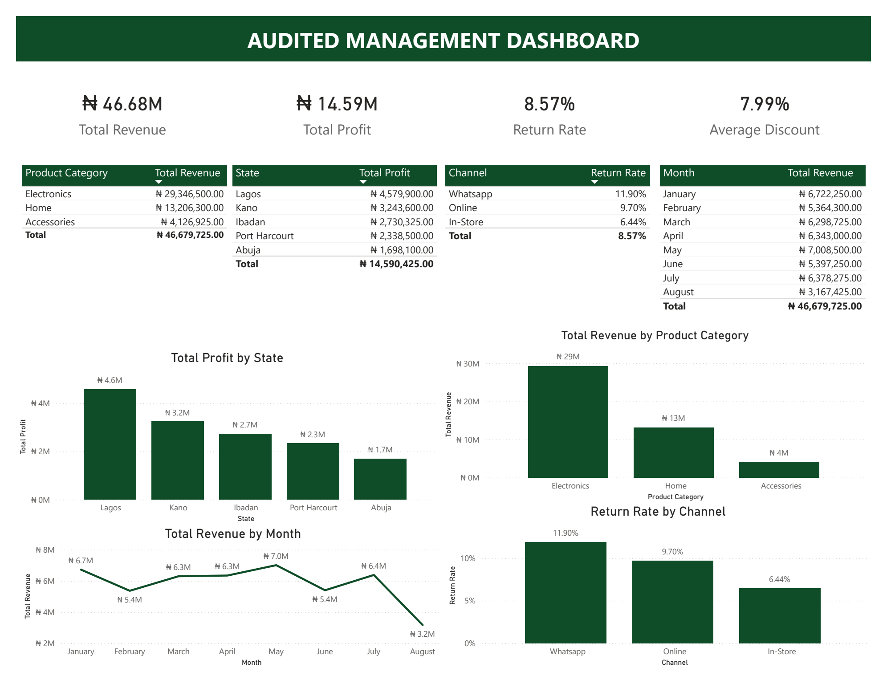
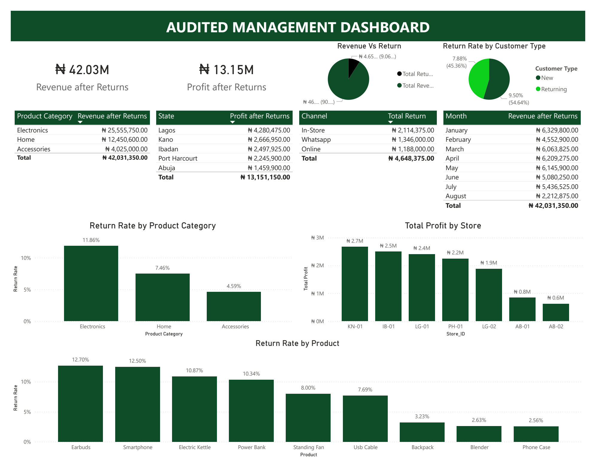
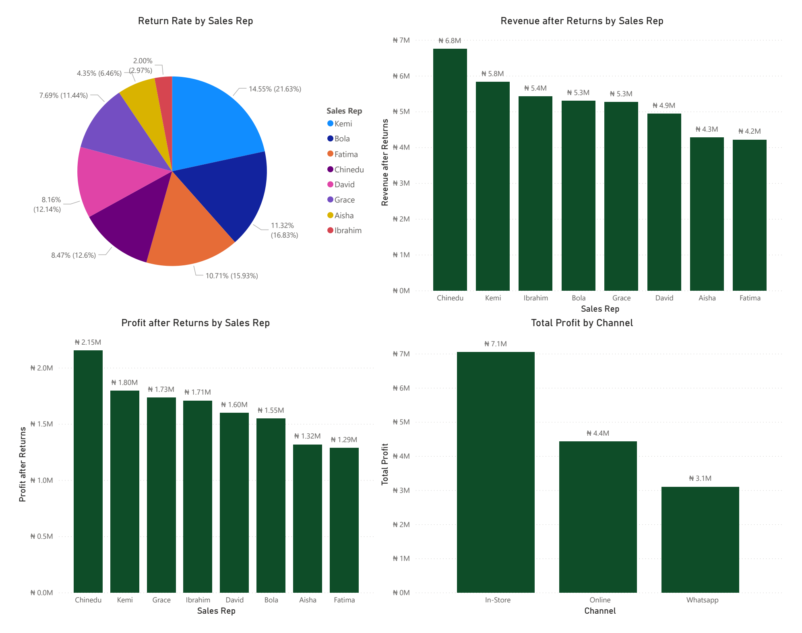
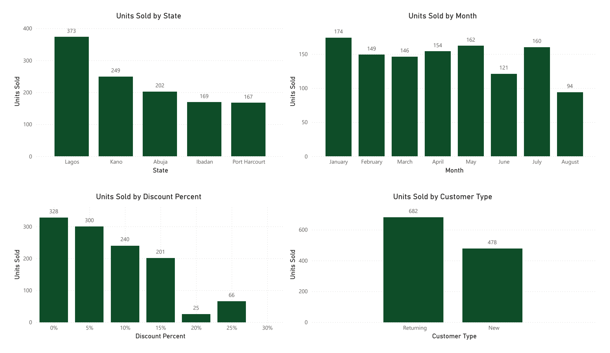

# Retail Performance Dashboard & Data Quality Audit

**Author:** Nathan Aguele  
**Tooling:** Power BI, Power Query, DAX, Excel  
**Context:** DSN (Data Science Nigeria) AI Bootcamp – Data Analytics Track

---

## Executive Summary

This project evaluates and audits a flawed management retail dashboard. The audit corrected arithmetic calculation errors, imputed missing unit costs, standardized categorical data, and exposed financial distortions caused by unapplied discounts and product returns.

---

## Audited Metrics vs. Flawed Baseline

| Metric | Original Flawed Baseline | Corrected / Audited Value | Post-Returns Realized Value |
| :--- | :--- | :--- | :--- |
| **Gross Revenue** | ₦47,500,870.00 | **₦46,679,725.00** | **₦42,031,350.00** |
| **Gross Profit** | ₦16,617,270.00 | **₦14,590,425.00** | **₦13,151,150.00** |
| **Total Returns Lost** | *Unreported* | — | **₦4,648,375.00** |
| **Return Rate** | *Unreported* | **8.57** | **8.57%** |
| **Average Discount** | *Unreported* | **7.99%** | — |

---

## Executive Audit: Debunking Key Claims

1. **Abuja Market Profitability (Claim: "Abuja is the most profitable market")**
   * **Verdict: INCORRECT.**
   * **Evidence:** Abuja is the **least profitable** market across all operations, yielding only ₦1.70M in profit (₦1.46M post-returns). Lagos generated the highest profit at ₦4.58M (₦4.28M post-returns).

2. **Discounting Impact (Claim: "Higher discounting is improving profitability")**
   * **Verdict: MISLEADING & INCORRECT.**
   * **Evidence:** Profit margins eroded under heavier discounts. Transactions with 0% discount had the highest volume of units sold (328 units), whereas transactions at 25% and 30% discounts accounted for only 66 and 25 units without driving profitability.

3. **Online Channel Reliability (Claim: "The Online channel has the lowest return rate")**
   * **Verdict: INCORRECT.**
   * **Evidence:** The Online channel recorded a 9.70% return rate (second highest). The channel with the lowest return rate was **In-Store** at 6.44%, while WhatsApp had the highest return rate at 11.90%.

4. **Monthly Seasonality (Claim: "August is the strongest sales month")**
   * **Verdict: INCORRECT.**
   * **Evidence:** August recorded the lowest sales in the dataset (₦3.17M gross, ₦2.21M post-returns). Gross revenue peaked in **May (₦7.01M)**, while **January** led post-returns realized revenue (₦6.33M) and units sold (174 units).

5. **Decision Readiness (Claim: "The reported revenue field can be used directly")**
   * **Verdict: INCORRECT.**
   * **Evidence:** Raw revenue figures failed to apply discounts and omitted product returns, overstating actual company cash flow by **₦5,469,520.00**.

---

## Data Cleaning & Transformation Pipeline

* **Categorical Normalization:** Resolved trailing whitespace, casing mismatches (`Lagos` vs. `LAGOS`), and inconsistent pluralization (`Accessory` vs. `Accessories`).
* **Missing Cost Imputation:** Corrected `null` values within `Cost_Per_Unit_NGN` using conditional column rules to prevent phantom profit inflation.
* **Discount Calculation Repairs:** Recalculated revenue across all records via `Unit_Price * Quantity * (1 - Discount_Pct)` before recomputing profit.
* **Data Typing:** Enforced strict column data types (currency, integer, percentage decimal, date-only).

---

## Reconstructed Power BI Dashboard

### 1. Gross Performance & Regional Distribution



### 2. Post-Returns Realization & Risk Analysis



### 3. Sales Representative Attribution & Customer Segments



### 4. Volume Deep Dive & Discount Elasticity



---

## Strategic Recommendations

1. **Prioritize In-Store Retail Expansion:** Focus physical capital on physical stores (`In-Store`), which demonstrate the lowest return risk (6.44%) and highest net margins. Stores in Kano (`KN-01`) and Ibadan (`IB-01`) produced higher individual store profits than single locations in Lagos.
2. **Phase Out Aggressive Discounting:** Restrict promotional discounting tiers. Demand is inelastic to higher discount brackets, which currently erode baseline margins.
3. **Address High-Return Products in Digital Channels:** Audit the WhatsApp and Online sales channels (11.90% and 9.70% return rates), focusing on Electronics (Earbuds at 12.70%, Smartphones at 12.50%).

---

## Repository Structure

```text
├── assets/         <- High-resolution dashboard view exports
├── data/           <- Raw and audited datasets (.xlsx)
├── docs/           <- Submission report PDF and documentation
└── src/            <- Production Power BI (.pbix) reporting model
